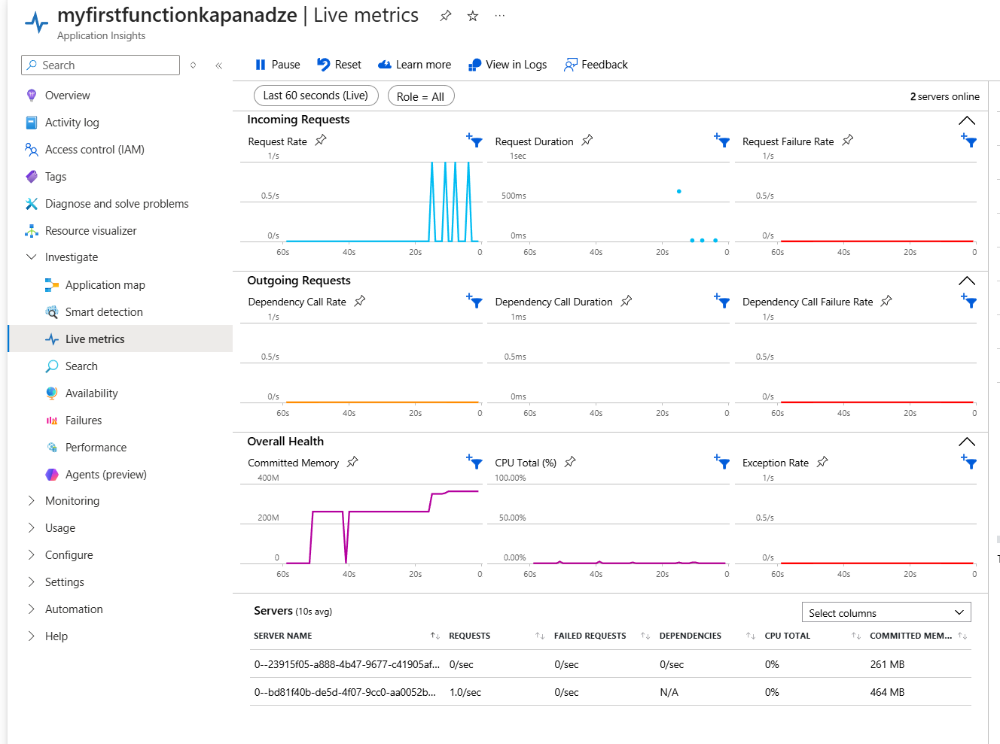
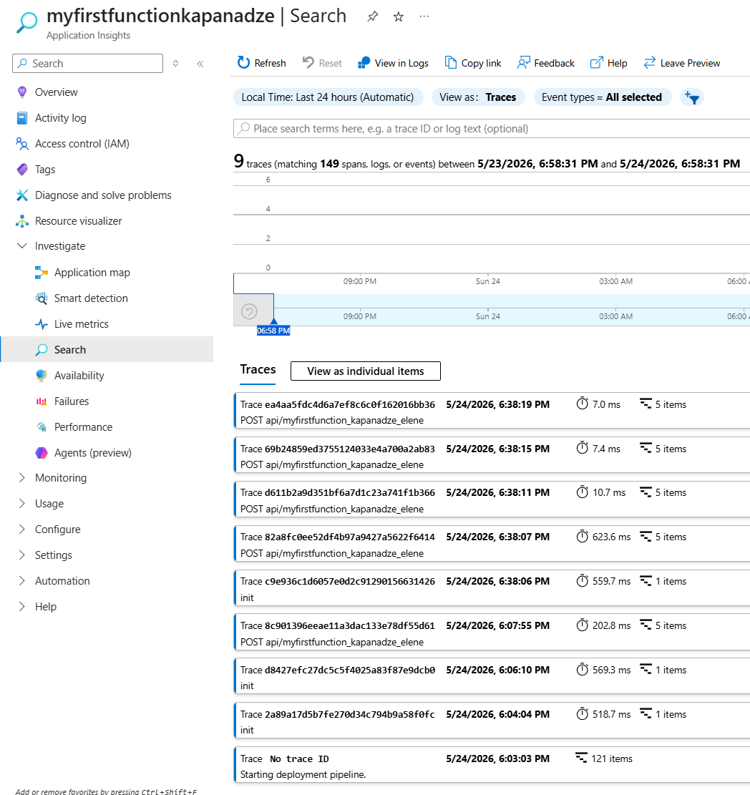
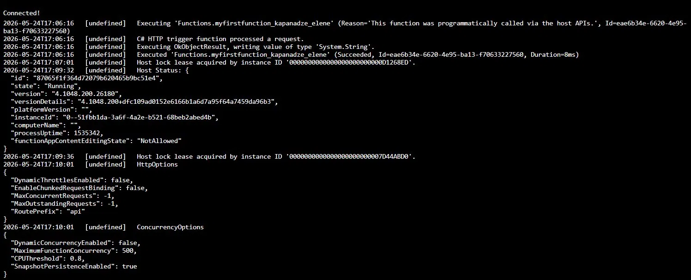
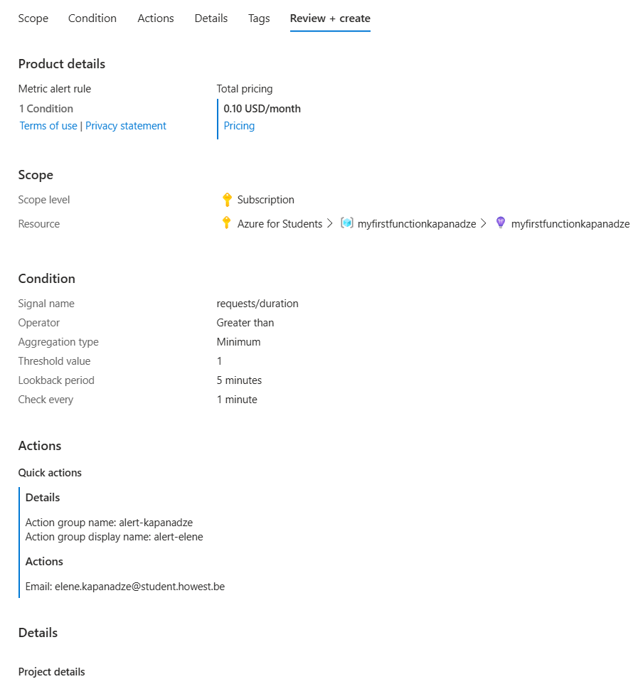
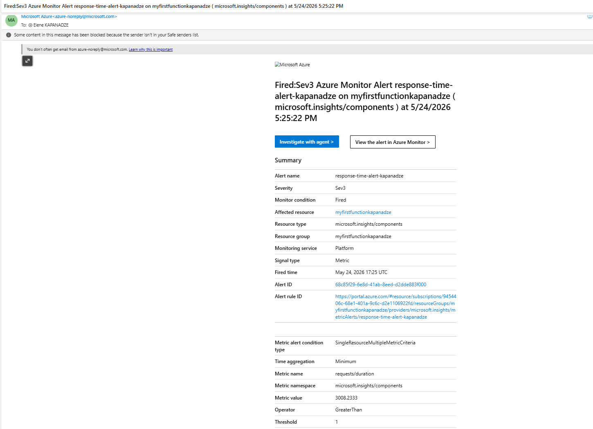
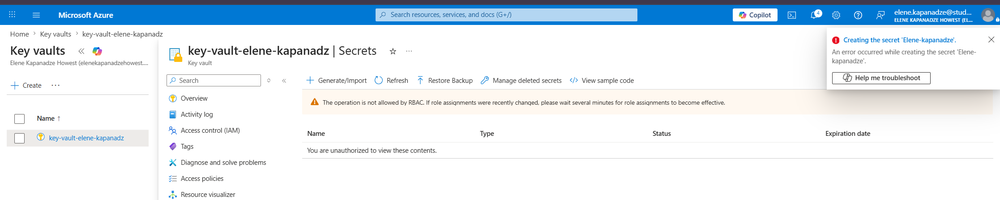
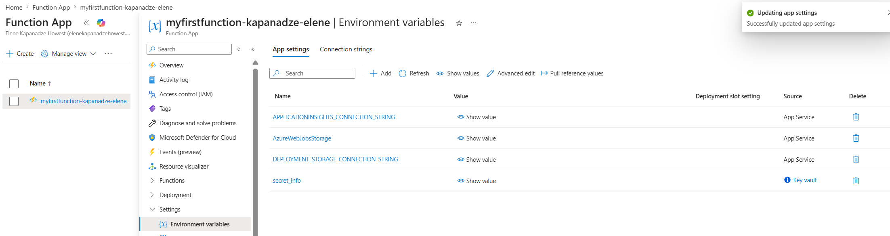
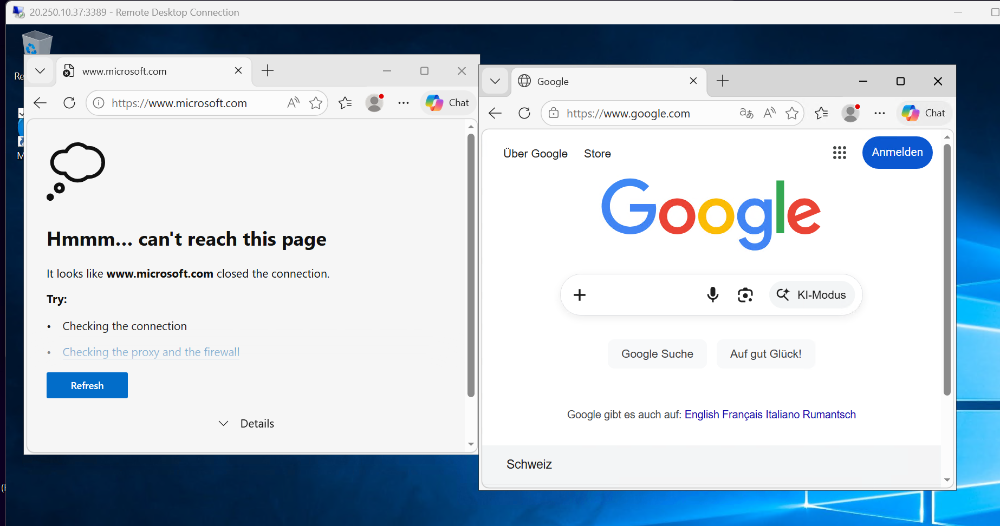

# Azure Functions, Monitoring & Security

_(Serverless functions, Application Insights, Key Vault, and Azure Firewall - built on an Azure with Students subscription.)_

Covers: building and deploying an Azure Function, monitoring it with
Application Insights, pulling secrets from Key Vault instead of hardcoding
them, and locking down outbound traffic with Azure Firewall.

Reference course: [Explore Azure Functions](https://learn.microsoft.com/en-us/training/modules/explore-azure-functions/1-introduction)

---

## 1. Concepts

- **Azure Functions vs. Logic Apps vs. WebJobs** - in an orchestration, the
  individual actions an app performs are _functions_, executed to complete
  a task. WebJobs run continuously inside an App Service (24/7); Functions
  are created when the app runs and disappear afterward.
- **Root folder files:**
  - `host.json` - metadata / global config options
  - `local.settings.json` - local app and tool settings ( it holds connection strings, not to be made public)
- **Other config**:
  - Deployed to Azure -> Application settings
  - Local machine -> `local.settings.json`
- **Trigger** - every function has exactly one; it defines how/when the
  function starts.
- **Binding** - connects the function to another resource, as an input,
  output, or both. Triggers and bindings let you avoid hardcoding access to
  other services.

---

## 2. Local Setup

1. Install **.NET** and the **Azure Functions Core Tools**
2. Install the **Azure Functions** extension in VS Code
3. `Ctrl+Shift+P` -> **Azure: Sign In**

### 2.1 Create the function project

`Ctrl+Shift+P` -> **Azure Functions: Create New Project**

| Question      | Answer                        |
| ------------- | ----------------------------- |
| Language      | C#                            |
| .NET runtime  | .NET 8.0 Isolated             |
| Template      | HTTP trigger                  |
| Function name | `myfirstfunction-placeholder` |
| Namespace     | `My.Functions`                |
| Access rights | Anonymous                     |

### 2.2 Provision the backing storage account (Azure)

Container for your data objects, such as blobs, files, queues, and tables. Every Function App needs a storage account, even for local dev:

```bash
az group create --name rg-lab2-placeholder --location switzerlandnorth

az storage account create \
  --name lab9placeholder \
  --resource-group rg-lab2-placeholder \
  --location switzerlandnorth \
  --sku Standard_LRS
```

Grab the connection string: **Storage accounts -> lab9placeholder -> Security +
networking -> Access keys -> Connection string (key1)**.

### 2.3 `local.settings.json`


```json
{
  "IsEncrypted": false,
  "Values": {
    "AzureWebJobsStorage": "DefaultEndpointsProtocol=https;AccountName=lab9placeholder;AccountKey=<STORAGE_ACCOUNT_KEY>;EndpointSuffix=core.windows.net",
    "FUNCTIONS_WORKER_RUNTIME": "dotnet-isolated"
  }
}
```

### 2.4 Run locally

`Ctrl+Shift+P` -> **Azurite: Start** (local storage emulator), then check
`Program.cs`:

```csharp
using Microsoft.Azure.Functions.Worker;
using Microsoft.Azure.Functions.Worker.Builder;
using Microsoft.Extensions.Hosting;

var builder = FunctionsApplication.CreateBuilder(args);

builder.ConfigureFunctionsWebApplication();

builder.Build().Run();
```

Press **F5** to run. The function starts locally:

```
myfirstfunction_placeholder: [GET,POST] http://localhost:7071/api/myfirstfunction_placeholder
```

You can also trigger it from the **Azure extension sidebar**: **Workspace ->
Local Project -> Functions -> myfirstfunction_placeholder -> Execute
Function Now...**

---

## 3. Deploy to Azure

1. `Ctrl+Shift+P` -> **Azure Functions: Create Function App in Azure**
   - Name: `myfirstfunction-placeholder`
   - Region: Switzerland North
   - Runtime: .NET 8
   - Storage: created automatically

   This provisions a resource group, an app service plan (Flex), a storage
   account, Application Insights, and the function app itself.

2. `Ctrl+Shift+P` -> **Azure Functions: Deploy to Function App** -> view
   output - deployment goes through validation, zip extraction, package
   upload, and worker sync, finishing with the live HTTP trigger URL:

   ```
   https://myfirstfunction-placeholder-<random>.switzerlandnorth-01.azurewebsites.net/api/myfirstfunction_placeholder
   ```

3. Trigger the deployed function from the Azure sidebar: **Resources ->
   your subscription -> Function App -> myfirstfunction-placeholder ->
   Functions -> Execute Function Now...** - response: `"Welcome to Azure
Functions!"`

4. The whole deployment lives in one resource group:
   **Resource groups -> myfirstfunctionplaceholder**

---

## 4. Monitoring with Application Insights

### 4.1 Live Metrics

1. **Application Insights -> myfirstfunctionplaceholder -> Investigate -> Live
   metrics**
2. Hit the function a few times - locally
   (`http://localhost:7071/api/myfirstfunction_placeholder`) and/or via
   **Execute Function Now** in the portal
3. Live Metrics shows request rate, request duration, failure rate, CPU,
   memory, and overall server health in real time


### 4.2 Search / individual request traces

**Investigate -> Search** -> time range **Last 24 hours** -> filter event type
**Request** -> **View as individual items** - shows each HTTP call with
timestamp, response code, and response time.



You can drill into a single trace for its **end-to-end transaction
details** (timing breakdown, custom properties, related telemetry).

### 4.3 Log stream

**Function App -> myfirstfunction-placeholder -> Monitoring -> Logs**
(or **Overview -> Log stream**) shows live console-style output as the
function executes - trigger the function again to watch it stream in.



### 4.4 Alert on slow responses

**Monitoring -> Alerts -> + Create -> Alert rule**

**Condition:**

| Field            | Value                |
| ---------------- | -------------------- |
| Signal name      | Server response time |
| Threshold        | Static               |
| Aggregation type | Minimum              |
| Operator         | Greater than         |
| Value            | 1 (second)           |

**Actions:**

| Field             | Value                         |
| ----------------- | ----------------------------- |
| Action group name | `alert-placeholder`           |
| Action type       | Email/SMS/Push/Voice          |
| Email             | your own notification address |

**Details:**

| Field           | Value                             |
| --------------- | --------------------------------- |
| Alert rule name | `response-time-alert-placeholder` |
| Severity        | any                               |



To actually trigger it, add an artificial delay in the function and
redeploy:

```csharp
public IActionResult Run([HttpTrigger(...)] HttpRequest req)
{
    _logger.LogInformation("C# HTTP trigger function processed a request.");
    Thread.Sleep(3000);
    return new OkObjectResult("Welcome to Azure Functions!");
}
```

(add `using System.Threading;` at the top), then **Azure Functions: Deploy
to Function App** and execute the function again. The alert fires and an
email arrives within a few minutes.



---

## 5. Secret Management with Key Vault

Instead of hardcoding secrets in code, the app fetches them from Key Vault
at runtime - this section proves the Function App and Key Vault can talk to
each other, by teaching the function to fetch a secret and log it.

### 5.1 Create the Key Vault

| Field                 | Value                                               |
| --------------------- | --------------------------------------------------- |
| Resource group        | `myfirstfunctionplaceholder` (same as the function) |
| Name                  | `key-vault-placeholder`                             |
| Region                | Switzerland North                                   |
| Pricing tier          | Standard                                            |
| Soft delete retention | 7 days                                              |
| Access                | keep default (Azure RBAC)                           |



### 5.2 Grant yourself access first

Trying to add a secret immediately after creation fails with a permissions
error - RBAC roles need to be assigned explicitly, even for the vault's
creator:

- Least privilege to **read** secrets only: **Key Vault Secrets User**
- Least privilege to **manage** secrets: **Key Vault Secrets Officer**

**Key Vault -> Access control (IAM) -> Add role assignment** -> select
**Key Vault Secrets Officer** -> assign to yourself.

### 5.3 Create a secret

**Objects -> Secrets -> + Generate/Import**

| Field | Value                     |
| ----- | ------------------------- |
| Name  | `secret-info-placeholder` |
| Value | `<your secret value>`     |

### 5.4 Give the Function App a managed identity

**Function App -> Settings -> Identity -> System assigned** tab -> **On**

### 5.5 Grant that identity access to the secret

**Key Vault -> Objects -> Secrets -> secret-info-placeholder -> Access
control (IAM) -> Add role assignment** -> **Key Vault Secrets User** ->
member type **Managed identity** -> select the function app.


### 5.6 Reference the secret from app settings

Copy the secret's identifier from **Objects -> Secrets -> (current
version)**, e.g.:

```
https://key-vault-placeholder.vault.azure.net/secrets/secret-info-placeholder/<version>
```

Wrap it in a Key Vault reference:

```
@Microsoft.KeyVault(SecretUri=https://key-vault-placeholder.vault.azure.net/secrets/secret-info-placeholder/<version>)
```

**Function App -> Settings -> Environment variables -> App settings -> Add:**

| Name          | Value                          |
| ------------- | ------------------------------ |
| `secret_info` | _(the reference string above)_ |



### 5.7 Read the secret in code

```csharp
public IActionResult Run([HttpTrigger(AuthorizationLevel.Anonymous, "get", "post")] HttpRequest req)
{
    _logger.LogInformation("C# HTTP trigger function processed a request.");
    Thread.Sleep(3000);
    string mySecret = Environment.GetEnvironmentVariable("secret_info");
    _logger.LogInformation(mySecret);
    return new OkObjectResult("Welcome to Azure Functions!");
}
```

Deploy again, then **Function App -> Monitoring -> Log stream**, execute the
function, and confirm the secret value shows up in the logs - proving the
Function App pulled it from Key Vault at runtime rather than from a
hardcoded value.

---

## 6. Azure Firewall

### 6.1 Network setup

1. Create a resource group: `placeholder-RG`
2. Create a virtual network `placeholder-VN` with two subnets:
   - `AzureFirewallSubnet` - **required exact name** - `10.0.1.0/26`
     (Subnet purpose: Azure Firewall)
   - `Placeholder-SN` - `10.0.2.0/24` - the workload subnet

### 6.2 Create the workload VM (no public IP)

```powershell
$RGName = "placeholder-RG"

Invoke-WebRequest -Uri "https://raw.githubusercontent.com/MicrosoftLearning/AZ-700-Designing-and-Implementing-Microsoft-Azure-Networking-Solutions/master/Allfiles/Exercises/M06/firewall.json" -OutFile "firewall.json"

Invoke-WebRequest -Uri "https://raw.githubusercontent.com/MicrosoftLearning/AZ-700-Designing-and-Implementing-Microsoft-Azure-Networking-Solutions/master/Allfiles/Exercises/M06/firewall.parameters.json" -OutFile "firewall.parameters.json"

New-AzResourceGroupDeployment -ResourceGroupName $RGName -TemplateFile firewall.json -TemplateParameterFile firewall.parameters.json
```

Template parameters used:

| Name            | Type         | Value                           |
| --------------- | ------------ | ------------------------------- |
| `vmName1`       | String       | `Srv-Work`                      |
| `nicName1`      | String       | `Srv-Work-nic`                  |
| `vmSize`        | String       | `Standard_D2s_v3`               |
| `adminUsername` | String       | `TestUser`                      |
| `adminPassword` | SecureString | _(set securely)_ |

The deployed VM has private IP `10.0.2.4` and, by design, no public IP -
it will only be reachable through the firewall's DNAT rule (section 6.5).

### 6.3 Create the firewall

Search **Firewall** -> **Create**

| Field               | Value                              |
| ------------------- | ---------------------------------- |
| Resource group      | `placeholder-RG`                   |
| Firewall name       | `placeholder-FW01`                 |
| Region              | Switzerland North                  |
| Firewall SKU        | Standard                           |
| Firewall management | Use a Firewall Policy              |
| Firewall policy     | Create new -> `placeholder-fw-pol` |
| Virtual network     | Use existing -> `placeholder-VN`   |
| Public IP           | Add new -> `placeholder-fw-pip`    |

Public IP from Overview: `20.250.10.37`

### 6.4 Route table

So the workload subnet actually sends its traffic through the firewall
instead of straight to the internet:

1. **Create a resource -> Route table**
2. Name: `placeholder-Firewall-route`
3. **Settings -> Subnets -> Associate** it with `placeholder-VN` /
   `Placeholder-SN`
4. **Settings -> Routes -> Add:**

   | Field                      | Value                                  |
   | -------------------------- | -------------------------------------- |
   | Route name                 | `placeholder-fw-dg`                    |
   | Address prefix destination | `0.0.0.0/0`                            |
   | Next hop type              | Virtual appliance                      |
   | Next hop address           | `10.0.1.4` (the firewall's private IP) |

### 6.5 Application rule - allow HTTP(S) to a specific site

**placeholder-fw-pol -> Rules -> Application Rules** -> add a rule collection:

| Field                  | Value                                 |
| ---------------------- | ------------------------------------- |
| Name                   | `placeholder-App-Coll01`              |
| Rule collection type   | Application                           |
| Priority               | 200                                   |
| Rule collection action | Allow                                 |
| Rule collection group  | DefaultApplicationRuleCollectionGroup |

Rule:

| Field            | Value            |
| ---------------- | ---------------- |
| Name             | `Allow-Google`   |
| Source type      | IP Address       |
| Source           | `10.0.2.0/24`    |
| Protocol         | http, https      |
| Destination type | FQDN             |
| Destination      | `www.google.com` |

### 6.6 Network rule - allow DNS

The workload VM needs DNS to resolve domain names (like `www.google.com`)
into IP addresses, so a network rule explicitly allows outbound DNS:

**placeholder-fw-pol -> Rules -> Network Rules** -> add a rule collection:

| Field                  | Value                             |
| ---------------------- | --------------------------------- |
| Name                   | `placeholder-Net-Coll01`          |
| Priority               | 200                               |
| Rule collection action | Allow                             |
| Rule collection group  | DefaultNetworkRuleCollectionGroup |

Rule:

| Field             | Value                        |
| ----------------- | ---------------------------- |
| Name              | `Allow-DNS`                  |
| Source type       | IP Address                   |
| Source            | `10.0.2.0/24`                |
| Protocol          | UDP                          |
| Destination Ports | 53                           |
| Destination type  | IP Address                   |
| Destination       | `209.244.0.3`, `209.244.0.4` |

### 6.7 DNAT rule - allow RDP in

Since the workload VM has no public IP, RDP has to be translated (DNAT)
through the firewall's public IP:

**placeholder-fw-pol -> Rules -> DNAT Rules** -> add a rule collection:

| Field                 | Value                          |
| --------------------- | ------------------------------ |
| Name                  | `placeholder-rdp`              |
| Rule collection type  | DNAT                           |
| Priority              | 200                            |
| Rule collection group | DefaultDnatRuleCollectionGroup |

Rule (`20.250.10.37:3389` -> `10.0.2.4:3389`):

| Field              | Value                               |
| ------------------ | ----------------------------------- |
| Name               | `rdp-nat`                           |
| Source type        | IP Address                          |
| Source             | `*`                                 |
| Protocol           | TCP                                 |
| Destination Ports  | 3389                                |
| Destination type   | IP Address                          |
| Destination        | `20.250.10.37` (firewall public IP) |
| Translated address | `10.0.2.4` (Srv-Work private IP)    |
| Translated port    | 3389                                |

### 6.8 Point the VM's DNS at the firewall's allowed servers

1. **Resource groups -> placeholder-RG -> Srv-Work-nic -> Settings -> DNS
   servers** -> Custom
2. Add `209.244.0.3` and `209.244.0.4`
3. **Virtual machines -> Srv-Work -> Restart**

### 6.9 Test

1. `mstsc` -> `20.250.10.37`, log in as `TestUser`
2. Inside the VM, browse to `https://www.google.com` - **loads** (allowed
   by the application rule)
3. Browse to `https://www.microsoft.com` - **blocked** since only `www.google.com` was explicitly allowed

   

This confirms the firewall is enforcing allow-listed outbound access rather
than just passing everything through.

### 6.10 Cleanup

```powershell
Remove-AzResourceGroup -Name 'placeholder-RG' -Force -AsJob
```

---

## Notes / gotchas

- Key Vault RBAC doesn't automatically grant the creator access - you have
  to assign yourself a role (Secrets Officer/User) right after creating the
  vault, or the portal throws a permissions error the first time you try to
  add a secret.
- The DNS network rule (6.6) is easy to forget: without it, the VM can
  reach IPs directly but can't resolve domain names, which looks like a
  broader connectivity failure when it's really just DNS being blocked.
