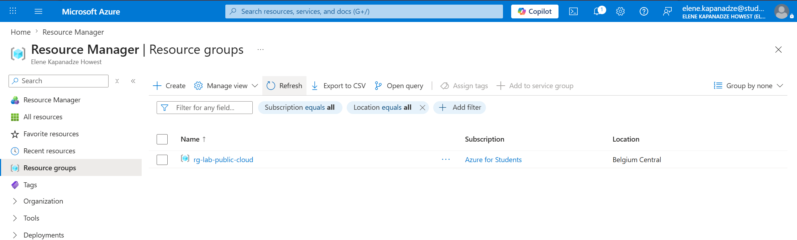
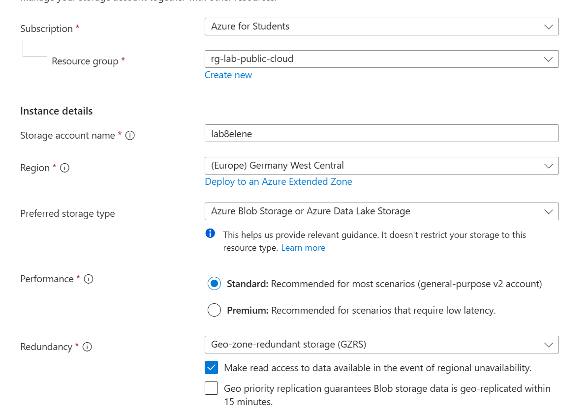
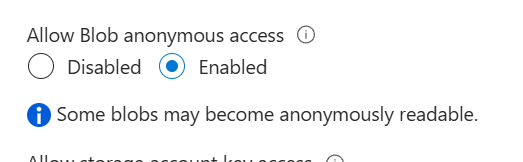
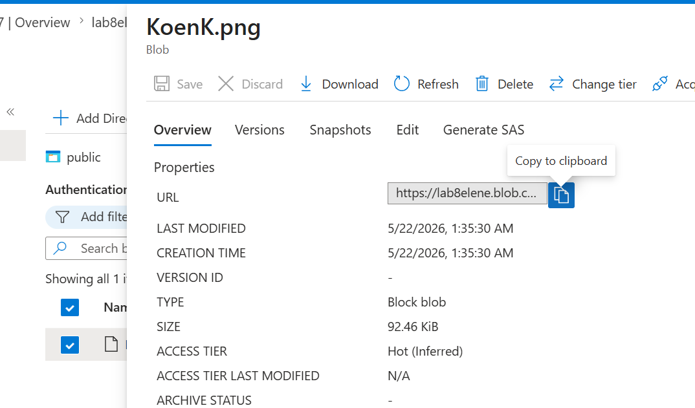
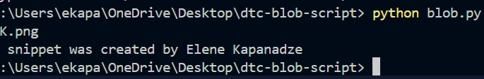
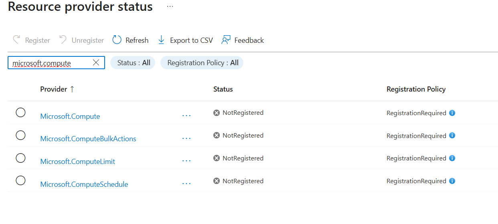
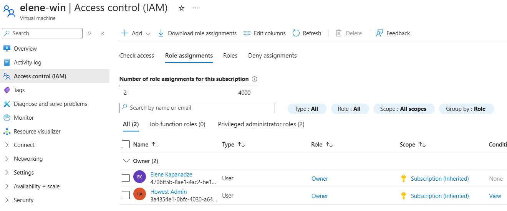
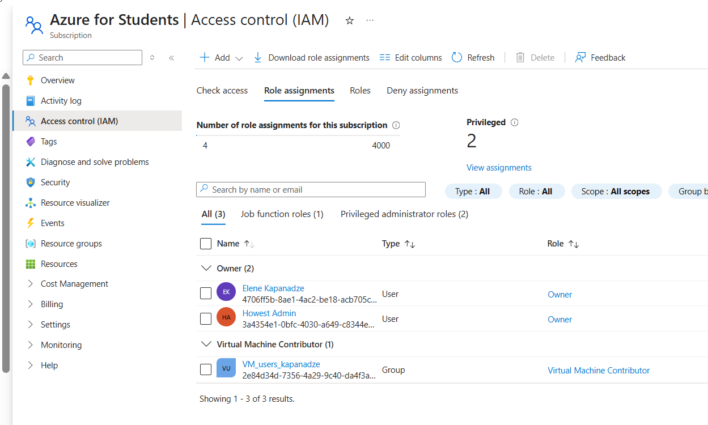
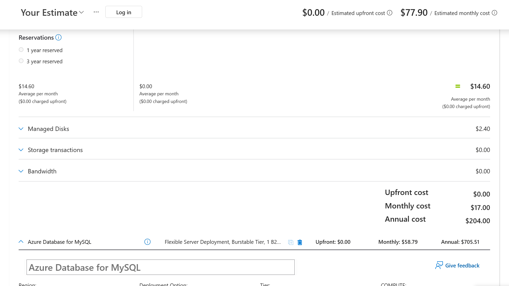
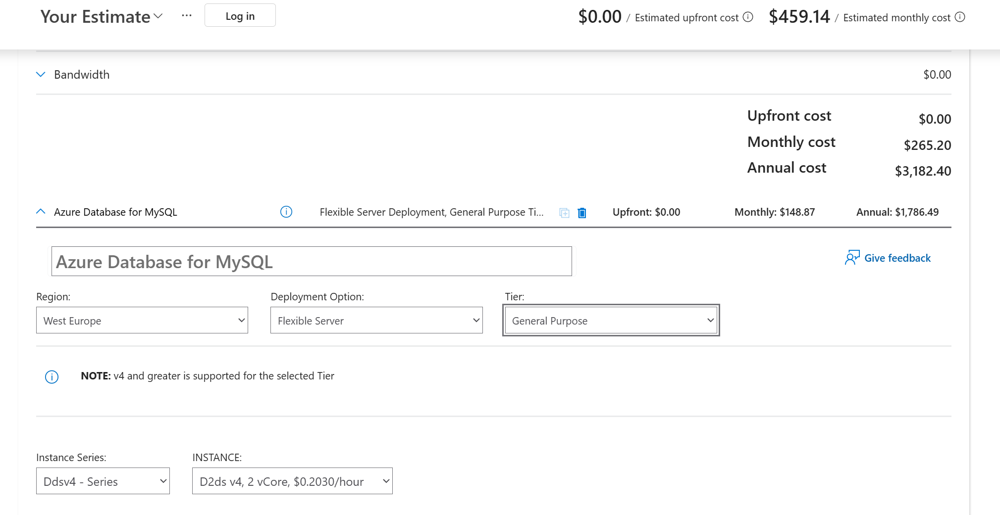

# Azure Infrastructure Fundamentals

*(Resource groups, networking, storage, a VM, and IAM - built on an Azure for Students subscription.)*

Covers: resource groups, virtual networks, Blob storage, a Windows Server VM
running IIS, IAM/RBAC, and Azure cost estimation.

Portal reference used throughout: [Microsoft Entra directory settings](https://portal.azure.com/#settings/directory)

---

## 1. Resource Group & Virtual Network

1. Create a resource group:
   - Search for **Resource groups** -> **Create**
   - Name: `rg-lab-public-cloud`

   

2. Create a virtual network:
   - **Create new** -> select the resource group above
   - Region: **Germany West Central**
   - Name: `vpc-placeholder`
   - Address space: `10.11.0.0/16` (delete the auto-created default subnet)
   - Subnet: `vm-subnet-placeholder-01`, range `10.11.1.0/24`
   - Under the subnet's NAT settings, disable the default outbound private
     address so VMs in this subnet can reach the internet (needed for things
     like web servers that must be reachable/able to phone out)

---

## 2. Storage Account & Blob Storage

**Goal (storage tutorial 1):**
- Create a storage account with high availability -> **GZRS**, with *read
  access to the secondary region* enabled
- Allow anonymous (public) read access to blobs
- Create a blob container for website documents
- Enable soft delete so files can be restored
- Enable blob versioning so changes are recoverable

### 2.1 Create the storage account

| Field | Value |
|---|---|
| Resource group | `rg-lab-public-cloud` |
| Storage account name | `lab8placeholder` |
| Region | Germany West Central |
| Performance | Standard |
| Redundancy | Geo-zone-redundant storage (GZRS), read access enabled |



### 2.2 Enable anonymous blob access

> Azure disables anonymous blob access by default at the **account level**.
> You have to turn it on here *before* a container's access level setting
> has any effect.

1. Storage account -> **Settings -> Configuration**
2. Set **Allow Blob anonymous access** to **Enabled** -> Save



### 2.3 Create a container and upload a file

1. Storage account -> **Data storage -> Containers** -> **+ Container**, name it
   `public`
2. Open the container -> **Change access level** -> set it to **Blob**
   (anonymous read for blobs, not the whole container list)
3. Upload a file (e.g. `Any.png`)
4. Click the file -> copy its **URL**
5. Open that URL in a browser - the file loads without authentication,
   confirming anonymous access works

   `https://lab8placeholder.blob.core.windows.net/public/Any.png`

   

### 2.4 Soft delete

1. Storage account -> **Overview -> Blob service**
2. Enable **Blob soft delete**, retention period **21 days**
3. Test:
   - Delete the uploaded file from the container
   - In the container view, switch the filter from **Only show active blobs**
     to **Show active and deleted blobs** - the deleted file appears with
     status `Deleted`
   - Right-click the file -> **Undelete** - status returns to `Current version`

### 2.5 Blob versioning

1. Storage account -> **Overview -> Blob service -> Versioning**
2. Enable **versioning for blobs**, keep all versions
3. Upload a new file with the **same name** as the existing one - Azure warns
   the file already exists; overwrite it
4. The previous copy now shows up under the blob's **Versions** tab, each
   with its own `versionId` and URL, e.g.:

   ```
   https://lab8placeholder.blob.core.windows.net/public/Any.png?versionId=2026-05-21T23:35:30.4949767Z
   ```

### 2.6 Access the blob from Python

1. Storage account -> **Security + networking -> Access keys** - copy `key1`
2. Install the SDK:

   ```bash
   pip install azure-storage-blob
   ```

3. Script - the key/secret handling below is the version I actually ran;
   for anything you publish, pull the key from an environment variable
   instead of hardcoding it as shown here:

   ```python
   from azure.storage.blob import BlobServiceClient
   import os

   account_name = "lab8placeholder"
   account_key = os.environ["AZURE_STORAGE_KEY"]  # set this locally, don't hardcode
   container_name = "public"

   connection_string = (
       f"DefaultEndpointsProtocol=https;AccountName={account_name};"
       f"AccountKey={account_key};EndpointSuffix=core.windows.net"
   )

   client = BlobServiceClient.from_connection_string(connection_string)
   container_client = client.get_container_client(container_name)

   for blob in container_client.list_blobs():
       print(blob.name)

   print("This snippet was created by Placeholder Name")
   ```

4. Run it:

   ```bash
   python blob.py
   ```

   

---

## 3. Windows Server VM + IIS

### 3.1 Create the VM (portal)

1. **Create a resource -> Create a resource** -> search *Windows Server* in
   the Marketplace
2. Choose **Windows Server 2019 Datacenter**
3. Fill in the standard networking/size/credentials wizard, then set it up

Before running commands against it, register the compute provider if it's
not already registered:

- **Subscriptions -> Resource providers** -> search `microsoft.compute` ->
  **Register** (all four `Microsoft.Compute*` providers)

  

### 3.2 Create the VM (CLI)

```bash
az vm create \
  --resource-group rg-lab-public-cloud \
  --name placeholder-win \
  --location switzerlandnorth \
  --image Win2019Datacenter \
  --size Standard_B2as_v2 \
  --admin-username azureuser \
  --admin-password '<VM_ADMIN_PASSWORD>' \
  --vnet-name vpc-placeholder-swiss \
  --subnet vm-subnet-placeholder-swiss \
  --public-ip-sku Standard
```

> Replace `<VM_ADMIN_PASSWORD>` with a strong password  and keep


Result:

| Field | Value |
|---|---|
| Name | `placeholder-win` |
| Location | Switzerland North |
| Private IP | `10.0.0.5` |
| Public IP | `20.203.242.149` |

**Planned follow-up tasks for this VM** (server role): install FTP and open
the ports it needs, install the camera system's proprietary video codec, and
install the transcoding service that processes uploaded videos.

### 3.3 Connect and configure IIS

1. On the host machine: `Win+R` -> `mstsc` -> connect to `20.203.242.149` as
   `azureuser`
2. Inside the VM: **Server Manager -> Add roles and features -> Server roles ->
   Web Server (IIS)** -> Install
3. Edit the default page:
   - File Explorer -> `C:\inetpub\wwwroot\` -> open `iisstart.htm` in Notepad
   - Add `<h1>Placeholder Name</h1>` inside the body, save
   - Verify locally in the VM: `http://localhost`
4. Open port 80 on the VM's NSG so the site is reachable from outside
   (this opens an inbound security-group rule - it isn't NAT-style "port
   forwarding" despite the loose wording in the original notes):

   ```bash
   az vm open-port \
     --resource-group rg-lab-public-cloud \
     --name placeholder-win \
     --port 80
   ```

5. From the host machine, browse to `http://20.203.242.149` - the edited
   IIS welcome page loads.

   

6. Shut the VM down when done (**Virtual machines -> placeholder-win -> Stop**) to
   avoid unnecessary compute charges.

### 3.4 Resize the OS disk

1. **Resource groups -> rg-lab-public-cloud -> placeholder-win_OsDisk...**
2. **Size** -> change to `2048 GiB` -> Save
3. Start the VM again, RDP back in
4. Inside Windows: `Win+R` -> `diskmgmt.msc` -> **C: -> Extend Volume** ->
   finish the wizard so Windows actually uses the new disk size

---

## 4. Linux VM (extra)

```bash
az vm create \
  --resource-group rg-lab-public-cloud \
  --name vm-placeholder-01 \
  --location switzerlandnorth \
  --image Ubuntu2204 \
  --size Standard_B2as_v2 \
  --storage-sku Standard_LRS \
  --admin-username placeholderadmin \
  --generate-ssh-keys \
  --vnet-name vpc-placeholder-swiss \
  --subnet vm-subnet-placeholder-swiss
```

Connect from Cloud Shell:

```bash
ssh placeholderadmin@20.208.40.201
```

---

## 5. Identity and Access Management (IAM)

**Microsoft Entra ID** manages permissions in Azure AD/Entra.

### 5.1 Check your own role

1. **Entra ID -> Manage -> Roles and administrators**
2. If your account shows an assigned-number value against a role in that
   list, that's your permission - in this case, **Global Administrator**
3. A role labelled **privileged** can grant/perform any permission,
   including granting permissions to other users
4. You can also check per-resource: **Virtual machines -> placeholder-win -> Access
   control (IAM) -> Role assignments**

   

### 5.2 Create a limited user

1. **Entra ID -> Manage users -> New user**
2. Create `padawan_placeholder` with no roles assigned
3. Log in as that user from a different browser (or private window) and
   confirm they see nothing under **Microsoft Entra ID**, **Virtual
   Machines**, or **Virtual Networks** - no role means no visibility

### 5.3 Grant scoped access

1. `placeholder-win` -> **Access control (IAM) -> Add -> Add role assignment**
2. Role: **Virtual Machine Contributor** -> assign to `padawan_placeholder`
3. Refresh the VM list on that user's session - `placeholder-win` now appears

### 5.4 Prove role scoping with a second VM

```bash
az vm create \
  --resource-group rg-lab-public-cloud \
  --name vm-placeholder-02 \
  --location switzerlandnorth \
  --image Ubuntu2204 \
  --size Standard_B2as_v2 \
  --storage-sku Standard_LRS \
  --admin-username placeholderadmin \
  --ssh-key-values ~/.ssh/id_rsa.pub \
  --vnet-name vpc-placeholder-swiss \
  --subnet vm-subnet-placeholder-swiss
```

`padawan_placeholder` was **not** given a role on this second VM, so it does
not show up for that user - confirming role assignments are scoped per
resource, not account-wide.

### 5.5 Group-based permissions

Assigning roles per-VM doesn't scale - using a security group is the better
pattern:

1. **Entra ID -> Manage -> Groups** -> **New group**
2. Group type: **Security**, name `VM_users_placeholder`, member: `padawan`
3. Grant the group **Virtual Machine Contributor** at the **subscription**
   level (broader scope than a single resource):
   - **Subscriptions -> IAM -> Add role assignment** -> **Virtual Machine
     Contributor** -> select the member group

   

With this, any member of `VM_users_placeholder` automatically gets Contributor
access on every VM in the subscription, present and future - no per-VM
assignment needed.

---

## 6. Cost Estimation

Using the [Azure Pricing Calculator](https://azure.microsoft.com/en-us/pricing/calculator/):

1. Add to estimate:
   - 1× **A0** virtual machine, 16 GB standard SSD
   - 50 GB **Azure Blob Storage** (images / persistent data)
   - **Azure Database for MySQL** - Single Server, Basic tier, 1 vCore

   Estimated cost 2025: **~$17/month**

   

2. Re-priced after changing the requirements (larger MySQL tier, General
   Purpose, more compute):

   Estimated cost 2025: **~$265/month**

   

---

## 7. Cleanup

```bash
az group delete --name rg-lab-public-cloud --yes --no-wait
az group delete --name NetworkWatcherRG --yes --no-wait
```

---

## Notes / gotchas

- **Least-privilege reminder:** for pushing container images to an Azure
  Container Registry, the role with the fewest privileges that still allows
  pushing is **AcrPush**.
- Anonymous blob access has two layers - account-level (`Configuration` blade)
  and container-level (`Change access level`). Both need to be set; the
  account-level toggle is off by default and easy to miss.
- `az vm open-port` opens an NSG inbound rule; it's not port forwarding in
  the router/NAT sense.
